# Hybrid RAG Studio

[](LICENSE)
[](https://www.python.org/)
[](https://github.com/patilakshay111/hybrid-rag-studio/actions/workflows/tests.yml)

A production-minded, open-source Python 3.11+ RAG application for Markdown, text, HTML, and PDF documents. It supports local FAISS/BM25 retrieval and shared Qdrant/PostgreSQL dense and full-text retrieval, weighted Reciprocal Rank Fusion, an optional cross-encoder reranker (enabled by default), grounded OpenAI answers, per-claim citation checks, and confidence scoring.

The workflow is implemented as a LangGraph `StateGraph` with Pydantic state and an in-memory `MemorySaver` checkpoint per `thread_id`, retaining the latest 20 conversation turns. The FastAPI service exposes ingestion and question endpoints; the Streamlit dashboard supports side-by-side hybrid and dense-only answers.

Contributions and issue reports are welcome. See [CONTRIBUTING.md](./CONTRIBUTING.md) for the development and pull request workflow.

## Local multi-service stack

The Compose file starts the API and dashboard plus local Postgres, Redis,
Qdrant, Keycloak, and Mailpit services. Generate local-only service passwords
and an encryption key, then add your OpenAI key:

```powershell
python scripts/init_local_env.py
notepad .env
docker compose up --build
```

The dashboard is at <http://localhost:8501>, the API at
<http://localhost:8000/docs>, Keycloak at <http://localhost:8080>, and the
Mailpit inbox at <http://localhost:8025>. All host ports bind to loopback.
Docker Desktop (or another Docker Engine) must be running.
Compose runs the Alembic database migration before starting the API.
For an externally managed PostgreSQL database, run `alembic upgrade head`
with that environment's `DATABASE_URL` before deploying the API.

To turn on Keycloak login:

1. Open the `hybrid-rag` realm in Keycloak. Create a confidential OIDC client
   named `hybrid-rag-dashboard` with standard flow enabled and redirect URI
   `http://localhost:8501/oauth2callback`. Copy its generated client secret
   into a local `.streamlit/secrets.toml`, using
   `.streamlit/secrets.toml.example` as the template. Generate a unique
   `cookie_secret`; do not use the example value.
2. Add an audience mapper to the client so its access tokens include
   `hybrid-rag-api` in `aud`.
3. Set `OIDC_ISSUER_URL=http://localhost:8080/realms/hybrid-rag`,
   `OIDC_JWKS_URL=http://keycloak:8080/realms/hybrid-rag/protocol/openid-connect/certs`,
   and `STREAMLIT_OIDC_ENABLED=true` in `.env`, then restart the stack.
4. Open registration requires email verification. Local verification and
   password-reset messages appear in Mailpit. To enable Google login, configure
   a Google identity provider in the Keycloak realm with OAuth credentials
   created in your own Google Cloud project; never put those credentials in
   source control or this chat.

The API verifies Keycloak access-token signatures, issuer, audience, and
expiry. It provisions each authenticated subject's personal workspace and
resolves workspace membership and application roles from PostgreSQL on every
request; workspace IDs and roles in token or browser claims are not trusted.
Select a shared workspace with the `X-Workspace-ID` request header. The
`platform-admin` Keycloak realm role grants platform-level administration;
the `admin`, `ceo`, `employee`, and `hr` roles are global role definitions
assigned to users through workspace memberships.

Authenticated users can list their workspaces and read the global role
catalog. Workspace admins can administer memberships and invite users only
within their workspace. Only platform admins can create global role
definitions or administer across workspaces. Invitation acceptance requires
the invitee's verified OIDC email to match the invitation; invitation tokens
are stored hashed, expire after the configured period (72 hours by default),
and can be accepted once. Configure `SMTP_*` in `.env`; Compose sends mail to
Mailpit. Privileged cross-workspace API access is recorded in PostgreSQL with
an action, target, actor, timestamp, and request ID, without recording prompts,
documents, answers, or tokens. The API applies workspace, owner, and role ACL
checks before returning documents or passing retrieved evidence to the answer
graph. Conversation checkpoints are namespaced by user and workspace.

With OIDC enabled, each user can save, rotate, or delete their own OpenAI key
from the dashboard. The API encrypts keys in Postgres using
`USER_KEY_ENCRYPTION_KEY`; generate a fresh key for every deployment and keep a
secure backup, because losing it makes stored credentials undecryptable. Key
plaintext is not returned by the API. In local development without OIDC, the
legacy shared `OPENAI_API_KEY` remains available.

**This is an in-progress production-hardening effort, not a production-ready
deployment.** Workspace authorization, invitation APIs, and cross-workspace
audit logging are implemented and covered by offline tests. When both
`QDRANT_URL` and `DATABASE_URL` are configured, ingestion writes vectors to
Qdrant and current chunks to the PostgreSQL catalog, and retrieval uses those
shared stores. Native development without both settings continues to use local
FAISS and BM25. Conversation checkpoints remain in memory; Redis caching,
OpenTelemetry, and deployment automation still need implementation and
validation. Kubernetes is out of scope. GitHub Actions currently runs the
offline tests, then validates Compose and builds the container image; it does
not publish or deploy an image. The Compose stack has not been started in this
environment because the Docker Engine is unavailable. Render will be tested
after local implementation and validation. Do not expose this stack to the
public internet or ingest confidential documents yet.

## Production data flow

These diagrams follow the implemented ingestion and question-answering paths.
With both `QDRANT_URL` and `DATABASE_URL` configured, Qdrant provides dense
candidates and PostgreSQL provides the current-chunk catalog and full-text
search. Otherwise, retrieval uses the local FAISS snapshot and in-process
BM25. Document embeddings and answer/judge calls use the configured OpenAI
models.

### Ingestion and index publication

```mermaid
%%{init: {'theme': 'dark', 'themeVariables': { 'primaryColor': '#0d1b2a', 'primaryTextColor': '#ffffff', 'primaryBorderColor': '#4cc9f0', 'lineColor': '#4cc9f0', 'secondaryColor': '#1b263b', 'tertiaryColor': '#4cc9f0' }}}%%
flowchart LR
    upload["Document upload"] --> api["POST /v1/ingest"]
    samples["Sample documents"] --> seed["seed.py"]
    archive["Archived documents"] --> reindex["reindex.py<br/>verify source hash"]
    api --> ingest["Parse and chunk<br/>selected strategy"]
    seed --> ingest
    reindex --> ingest
    ingest --> embed["Embed chunks<br/>configured OpenAI model"]
    embed --> dedupe["Deduplicate and replace<br/>this source's chunks"]
    dedupe --> durable{"QDRANT_URL and<br/>DATABASE_URL configured?"}
    durable -->|Yes| vectors["Upsert accepted vectors<br/>Qdrant with ACL payload"]
    vectors --> catalog["Replace workspace/source<br/>PostgreSQL catalog rows"]
    durable -->|No| stage["Write complete staged<br/>local index generation"]
    catalog --> stage
    stage --> publish["Atomically publish<br/>local index/CURRENT"]
    publish --> remote{"Durable mode?"}
    remote -->|Yes| cleanup["Delete superseded Qdrant IDs"]
    remote -->|No| active["Active local snapshot"]
    cleanup --> active
    cleanup --> qdrant["Qdrant collection"]

    classDef input fill:#0d1b2a,stroke:#4cc9f0,color:#ffffff;
    classDef process fill:#1b263b,stroke:#4cc9f0,color:#ffffff;
    classDef storage fill:#0d1b2a,stroke:#ffd166,color:#ffffff;
    classDef provider fill:#1b263b,stroke:#06d6a0,color:#ffffff;

    class upload,samples,archive input;
    class api,seed,reindex,ingest,dedupe process;
    class stage,publish,active,catalog,qdrant storage;
    class vectors process;
    class embed provider;
```



### Question answering

```mermaid
%%{init: {'theme': 'dark', 'themeVariables': { 'primaryColor': '#0d1b2a', 'primaryTextColor': '#ffffff', 'primaryBorderColor': '#4cc9f0', 'lineColor': '#4cc9f0', 'secondaryColor': '#1b263b', 'tertiaryColor': '#4cc9f0' }}}%%
flowchart LR
    client["Streamlit or API client"] --> ask["POST /v1/ask"]
    ask --> workflow["RAGService / LangGraph<br/>load thread history"]
    workflow --> query["Build query from question<br/>and recent history"]
    query --> embed["Embed query<br/>configured OpenAI model"]
    embed --> scope{"Shared stores configured?"}
    scope -->|Yes| dense["Qdrant dense search<br/>workspace/owner/role filters"]
    dense --> catalog["PostgreSQL catalog check<br/>current authorized chunk IDs"]
    catalog --> fusion["Fuse authorized candidates"]
    scope -->|Yes| lexical["PostgreSQL full-text search<br/>workspace/owner/role filters"]
    lexical --> fusion
    scope -->|No| local["FAISS dense +<br/>in-process BM25"]
    local --> fusion
    fusion --> rerank["Optional cross-encoder reranking"]
    rerank --> gate{"Retrieval confidence<br/>below threshold?"}
    gate -->|Yes| abstain["Return insufficient-context answer"]
    gate -->|No| answer["Generate grounded answer<br/>OpenAI"]
    answer --> citations["Verify cited claims<br/>LLM judge"]
    citations --> completeness["Assess completeness<br/>LLM judge"]
    abstain --> score["Calculate final confidence locally<br/>append turn to history"]
    completeness --> score
    score --> response["Return answer, evidence,<br/>citations, scores, thread_id"]
    response --> client

    classDef client fill:#0d1b2a,stroke:#4cc9f0,color:#ffffff;
    classDef service fill:#1b263b,stroke:#4cc9f0,color:#ffffff;
    classDef decision fill:#0d1b2a,stroke:#ffd166,color:#ffffff;
    classDef provider fill:#1b263b,stroke:#06d6a0,color:#ffffff;

    class client,response client;
    class ask,workflow,query,retrieve,embed,dense,catalog,lexical,local,fusion,rerank,abstain,score service;
    class gate decision;
    class answer,citations,completeness provider;
```



For low retrieval confidence, the graph skips answer generation, citation verification, and completeness judging; it returns an insufficient-context response instead. Otherwise, the confidence score combines retrieval confidence, citation coverage, and the completeness assessment. `POST /v1/compare` runs this answering path twice, once in hybrid mode and once in dense-only mode, using separate `-hybrid` and `-dense` thread IDs.

## Run the application on Windows

Use your installed global Python (3.11 or newer); this guide does not create a virtual environment. From the project root, check Python and install the project and its development tools into that Python installation:

```powershell
python --version
python -m pip install -e ".[dev]"
python scripts/init_local_env.py
notepad .env
```

In `.env`, set `OPENAI_API_KEY` to your real OpenAI API key. Keep `APP_ENV=development` for local use. `API_KEY` can remain blank for a local-only demo; if you set it, send the same value as `X-API-Key` when calling protected endpoints. Do not commit `.env`.
For native local development, leave `QDRANT_URL` blank; Docker Compose
configures its internal Qdrant service automatically. Shared retrieval
requires both `QDRANT_URL` and `DATABASE_URL`; production configuration uses
Qdrant and PostgreSQL. `QDRANT_VECTOR_SIZE` defaults to 1536 for the default
`text-embedding-3-small` model and must match the configured embedding model.
For this native-Python setup (not Docker Compose), set SQLite as the local
credential store in the API terminal before starting it:

```powershell
$env:DATABASE_URL = "sqlite:///./data/runtime/credentials.db"
```

Docker Compose overrides `DATABASE_URL` with its Postgres service address and
runs migrations automatically.

### 1. Index the bundled sample documents

```powershell
python -m rag_pipeline.seed
```

This embeds the sample corpus and publishes its local snapshot; when both
`QDRANT_URL` and `DATABASE_URL` are configured, it also writes to Qdrant and
the PostgreSQL chunk catalog. It requires `OPENAI_API_KEY`. Re-running it
refreshes the same sample documents. To select a chunking strategy, use
`python -m rag_pipeline.seed --strategy fixed`, `recursive`, or `semantic`.

### 2. Start the API and dashboard

Open two PowerShell terminals in the project root. Keep both running:

**Terminal 1 — API**
```text
python -m uvicorn rag_pipeline.api:app --reload
```

**Terminal 2 — Streamlit dashboard**
```text
python -m streamlit run src/rag_pipeline/ui.py
```

Open the dashboard at <http://localhost:8501>. The API health check is <http://localhost:8000/healthz>, and interactive API documentation is at <http://localhost:8000/docs>.

### 3. Use the application

- Ask questions in the dashboard. Answers include retrieved evidence, citations, confidence breakdowns, and citation-verification results.
- Turn on **Compare hybrid retrieval with dense-only retrieval** to see those two answers side by side.
- To ingest another Markdown, text, HTML, or PDF file, open <http://localhost:8000/docs>, expand `POST /v1/ingest`, select the file and chunking strategy, then execute the request. The API also supports `/v1/documents`, `/v1/ask`, and `/v1/compare`.
- The default reranker downloads its cross-encoder model the first time it is used; that first query may need network access. Set `RERANKER_ENABLED=false` in `.env` to disable it for a lightweight local run, then restart the API.
- To rebuild embeddings from the documents already indexed, run `python -m rag_pipeline.reindex`. This also requires the API key for OpenAI embeddings.

## Test and compare retrieval

### Run offline tests

These tests use deterministic local fakes and do not call OpenAI:

```powershell
python -m pytest
```

### Compare retrieval modes

The dashboard toggle compares **hybrid** (dense + lexical retrieval with
fusion) against **dense-only** for the same question. Local mode uses BM25;
shared mode uses PostgreSQL full-text search. `POST /v1/compare` returns both
results. To query sparse-only retrieval as well, use `POST /v1/ask` in the
API docs and choose `sparse`; the endpoint also accepts `hybrid` and `dense`.

For example, with the API running in local development mode and no `API_KEY` configured:

```powershell
$body = @{
    question = "What is the incident escalation process?"
    retrieval_mode = "sparse"
    thread_id = "readme-sparse-test"
} | ConvertTo-Json

Invoke-RestMethod `
    -Uri "http://localhost:8000/v1/ask" `
    -Method Post `
    -ContentType "application/json" `
    -Body $body
```

If `API_KEY` is configured, add `-Headers @{ "X-API-Key" = "<your API key>" }` to the request.

### Compare chunking strategies with the evaluation set

```powershell
python -m rag_pipeline.evaluation.run
```

This runs the 50-case golden set over **fixed**, **recursive**, and **semantic** chunking strategies, using hybrid retrieval for each. It writes JSON details and a Markdown comparison under `data/evaluation/results/`. Unlike the offline tests, this evaluation calls OpenAI for embeddings, answers, and LLM judging, so it requires `OPENAI_API_KEY`, can make many model calls, and may incur API costs. The report contains measured results from your run; no benchmark scores are assumed or prefilled.

## LangGraph local development

The root `langgraph.json` points the LangGraph CLI at the same compiled workflow used by `RAGService`, through `src/rag_pipeline/dev_graph.py`. The `dev` extra installs the local development CLI and requires `langgraph-api` 0.17.0 or newer:

```powershell
python -m langgraph_cli dev
```

Open the Studio URL printed by the CLI to inspect `internal_docs_rag`; the server and graph visualization start without an OpenAI key. Invoking the graph requires `OPENAI_API_KEY` and an indexed corpus. This is local development mode, not a LangSmith-hosted deployment.

## Repository layout

```text
src/rag_pipeline/   Application package, API, graph, UI, and CLI entrypoints
tests/              Offline unit and integration tests
data/sample_docs/   Synthetic sample corpus used by the demo
data/evaluation/    Golden evaluation dataset and generated results
docs/               Public project documentation
.private/           Local-only source/reference documents (Git-ignored)
```

The original requirements brief, interview rules, and engineering assessment are local references and are intentionally excluded from Git. The ignore rules are specific; Markdown files are not ignored globally, so the public docs and synthetic sample corpus remain part of the project.

See the [project recreation guide](./docs/PROJECT_RECREATION_GUIDE.md) and [case study](./docs/CASE_STUDY.md).

## API

- `GET /healthz`: process liveness.
- `GET /readyz`: readiness, including configured credential-store availability.
- `GET /v1/documents`: indexed document inventory.
- `POST /v1/ingest`: multipart document upload and chunking strategy.
- `POST /v1/ask`: grounded answer with citations, retrieved chunks, and confidence.
- `POST /v1/compare`: hybrid and dense-only responses for the same question.
- `GET`, `PUT`, `DELETE /v1/account/openai-key`: inspect whether the caller's
  key is saved, encrypt and save/rotate it, or delete it.
- `GET /v1/workspaces`: list caller memberships (platform admins can list all).
- `GET /v1/workspaces/{workspace_id}/members`: workspace-admin member listing.
- `POST /v1/workspaces/{workspace_id}/members`: add a user with existing roles.
- `PUT`, `DELETE /v1/workspaces/{workspace_id}/members/{user_id}`:
  update or remove a workspace member.
- `POST /v1/workspaces/{workspace_id}/invitations` and
  `POST /v1/invitations/{token}/accept`: send and accept verified-email
  invitations.
- `GET /v1/roles`, `POST /v1/roles`: read global roles; only platform admins
  can define new ones.

Protected API calls require a bearer token when `OIDC_ISSUER_URL` is set.
Workspace endpoints use current PostgreSQL membership, and privileged
cross-workspace access is audited. Invitation messages are delivered through
configured SMTP; local Compose uses Mailpit.

For local development, set `API_KEY` to require `X-API-Key`. If
`OIDC_ISSUER_URL` is configured, protected API routes require a verified bearer
token instead. Production startup requires HTTPS OIDC, PostgreSQL, encrypted
per-user key storage, and rejects wildcard CORS. Uploads are size-limited; raw
uploads and immutable index generations are stored under `DATA_DIR`.

## Architecture notes

- Without both `QDRANT_URL` and `DATABASE_URL`, FAISS `IndexFlatIP` stores normalized embeddings and supports exact cosine-ranked lookup on local disk. `chunks.json`, `vectors.npy`, and the FAISS index are committed as one generation behind an atomic pointer; BM25 is built from that snapshot.
- With both settings, Qdrant stores dense vectors with workspace, owner, and role payloads, while PostgreSQL stores the current chunk catalog and indexed full-text search data. Both stores apply authorization filters before ranking. Dense candidates are checked against the current catalog before fusion so stale Qdrant points are not returned.
- Durable ingestion writes accepted vectors, replaces the source's catalog rows in one database transaction, publishes the local snapshot, then removes superseded Qdrant point IDs. The Qdrant and PostgreSQL operations are not one cross-service transaction.
- Duplicate chunks with cosine similarity above the configured threshold are skipped.
- Confidence combines calibrated retrieval relevance, claim-level verified citation coverage, and an LLM completeness assessment. Low retrieval confidence returns a structured abstention.
- Original uploads are content-addressed under `DATA_DIR/raw`; `rag-pipeline-reindex` re-embeds the current document manifest without re-uploading.
- The default reranker is `cross-encoder/ms-marco-MiniLM-L-6-v2`. It loads on the first query and may need network access to download model weights; disable it for a lightweight offline test using `RERANKER_ENABLED=false`.
- The sample corpus is synthetic. Do not ingest confidential material into a demo environment.
