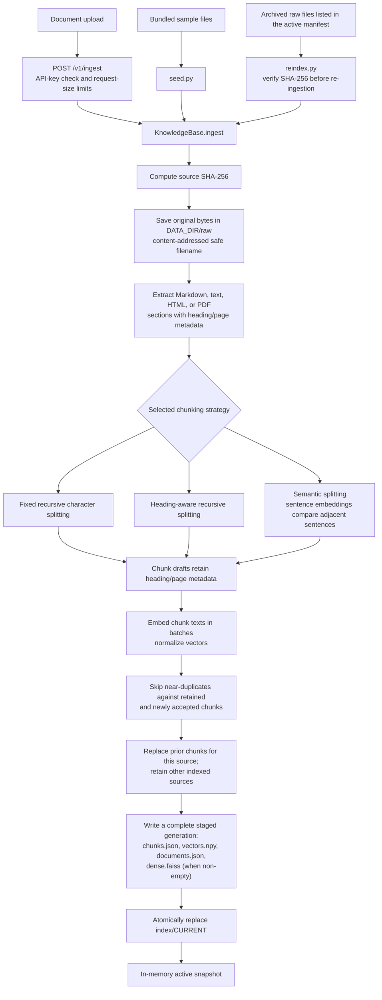
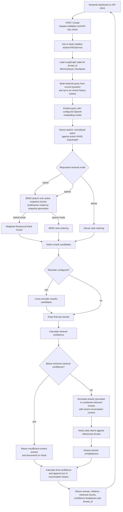

# Hybrid RAG Studio

[](LICENSE)
[](https://www.python.org/)
[](https://github.com/patilakshay111/hybrid-rag-studio/actions/workflows/tests.yml)

A production-minded, open-source Python 3.11+ RAG application for Markdown, text, HTML, and PDF documents. It combines local FAISS dense retrieval with BM25 keyword search, weighted Reciprocal Rank Fusion, an optional cross-encoder reranker (enabled by default), grounded OpenAI answers, per-claim citation checks, and confidence scoring.

The workflow is implemented as a LangGraph `StateGraph` with Pydantic state and an in-memory `MemorySaver` checkpoint per `thread_id`, retaining the latest 20 conversation turns. The FastAPI service exposes ingestion and question endpoints; the Streamlit dashboard supports side-by-side hybrid and dense-only answers.

Contributions and issue reports are welcome. See [CONTRIBUTING.md](./CONTRIBUTING.md) for the development and pull request workflow.

## Run the application on Windows

Use your installed global Python (3.11 or newer); this guide does not create a virtual environment. From the project root, check Python and install the project and its development tools into that Python installation:

```powershell
python --version
python -m pip install -e ".[dev]"
Copy-Item .env.example .env
notepad .env
```

In `.env`, set `OPENAI_API_KEY` to your real OpenAI API key. Keep `APP_ENV=development` for local use. `API_KEY` can remain blank for a local-only demo; if you set it, send the same value as `X-API-Key` when calling protected endpoints. Do not commit `.env`.

### 1. Index the bundled sample documents

```powershell
python -m rag_pipeline.seed
```

This embeds the sample corpus and builds the local FAISS index. It requires `OPENAI_API_KEY`. Re-running it refreshes the same sample documents. To select a chunking strategy, use `python -m rag_pipeline.seed --strategy fixed`, `recursive`, or `semantic`.

### 2. Start the API and dashboard

Open two PowerShell terminals in the project root. Keep both running:

**Terminal 1 — API**
```text
python -m uvicorn rag_pipeline.api:app --reload
```

**Terminal 2 — Streamlit dashboard**
```text
python -m streamlit run src/rag_pipeline/ui.py
```

Open the dashboard at <http://localhost:8501>. The API health check is <http://localhost:8000/healthz>, and interactive API documentation is at <http://localhost:8000/docs>.

### 3. Use the application

- Ask questions in the dashboard. Answers include retrieved evidence, citations, confidence breakdowns, and citation-verification results.
- Turn on **Compare hybrid retrieval with dense-only retrieval** to see those two answers side by side.
- To ingest another Markdown, text, HTML, or PDF file, open <http://localhost:8000/docs>, expand `POST /v1/ingest`, select the file and chunking strategy, then execute the request. The API also supports `/v1/documents`, `/v1/ask`, and `/v1/compare`.
- The default reranker downloads its cross-encoder model the first time it is used; that first query may need network access. Set `RERANKER_ENABLED=false` in `.env` to disable it for a lightweight local run, then restart the API.
- To rebuild embeddings from the documents already indexed, run `python -m rag_pipeline.reindex`. This also requires the API key for OpenAI embeddings.

## Test and compare retrieval

### Run offline tests

These tests use deterministic local fakes and do not call OpenAI:

```powershell
python -m pytest
```

### Compare retrieval modes

The dashboard toggle compares **hybrid** (dense + BM25 with fusion) against **dense-only** for the same question. `POST /v1/compare` returns both results. To query sparse-only retrieval as well, use `POST /v1/ask` in the API docs and choose `sparse`; the endpoint also accepts `hybrid` and `dense`.

For example, with the API running in local development mode and no `API_KEY` configured:

```powershell
$body = @{
    question = "What is the incident escalation process?"
    retrieval_mode = "sparse"
    thread_id = "readme-sparse-test"
} | ConvertTo-Json

Invoke-RestMethod `
    -Uri "http://localhost:8000/v1/ask" `
    -Method Post `
    -ContentType "application/json" `
    -Body $body
```

If `API_KEY` is configured, add `-Headers @{ "X-API-Key" = "<your API key>" }` to the request.

### Compare chunking strategies with the evaluation set

```powershell
python -m rag_pipeline.evaluation.run
```

This runs the 50-case golden set over **fixed**, **recursive**, and **semantic** chunking strategies, using hybrid retrieval for each. It writes JSON details and a Markdown comparison under `data/evaluation/results/`. Unlike the offline tests, this evaluation calls OpenAI for embeddings, answers, and LLM judging, so it requires `OPENAI_API_KEY`, can make many model calls, and may incur API costs. The report contains measured results from your run; no benchmark scores are assumed or prefilled.

## LangGraph local development

The root `langgraph.json` points the LangGraph CLI at the same compiled workflow used by `RAGService`, through `src/rag_pipeline/dev_graph.py`. The `dev` extra installs the local development CLI and requires `langgraph-api` 0.17.0 or newer:

```powershell
python -m langgraph_cli dev
```

Open the Studio URL printed by the CLI to inspect `internal_docs_rag`; the server and graph visualization start without an OpenAI key. Invoking the graph requires `OPENAI_API_KEY` and an indexed corpus. This is local development mode, not a LangSmith-hosted deployment.

## Repository layout

```text
src/rag_pipeline/   Application package, API, graph, UI, and CLI entrypoints
tests/              Offline unit and integration tests
data/sample_docs/   Synthetic sample corpus used by the demo
data/evaluation/    Golden evaluation dataset and generated results
docs/               Public project documentation
.private/           Local-only source/reference documents (Git-ignored)
```

The original requirements brief, interview rules, and engineering assessment are local references and are intentionally excluded from Git. The ignore rules are specific; Markdown files are not ignored globally, so the public docs and synthetic sample corpus remain part of the project.

See the [project recreation guide](./docs/PROJECT_RECREATION_GUIDE.md) and [case study](./docs/CASE_STUDY.md).

## API

- `GET /healthz`: process health.
- `GET /v1/documents`: indexed document inventory.
- `POST /v1/ingest`: multipart document upload and chunking strategy.
- `POST /v1/ask`: grounded answer with citations, retrieved chunks, and confidence.
- `POST /v1/compare`: hybrid and dense-only responses for the same question.

Set `API_KEY` to require `X-API-Key` authentication. Production startup requires both `API_KEY` (at least 32 characters) and `OPENAI_API_KEY`, and rejects wildcard CORS. Uploads are size-limited; raw uploads and immutable index generations are stored under `DATA_DIR`.

## Production data flow

These diagrams follow the implemented ingestion and question-answering paths. The index is local FAISS; document embeddings and answer/judge calls use the configured OpenAI models. BM25 is rebuilt from the exact active chunk snapshot on the first sparse or hybrid search for that generation, then cached in process.

### Ingestion and index publication



`seed.py` feeds the bundled sample files into the same ingestion method. `reindex.py` reads only documents in the active manifest, verifies each archived source digest, and re-ingests it using its recorded strategy unless another is selected. An ingestion failure does not switch the `CURRENT` pointer to an incomplete generation.

### Question answering



For low retrieval confidence, the graph skips answer generation, citation verification, and completeness judging; it returns an insufficient-context response instead. Otherwise, the confidence score combines retrieval confidence, citation coverage, and the completeness assessment. `POST /v1/compare` runs this answering path twice, once in hybrid mode and once in dense-only mode, using separate `-hybrid` and `-dense` thread IDs.

## Architecture notes

- FAISS `IndexFlatIP` stores normalized embeddings and supports exact cosine-ranked lookup on local disk. `chunks.json`, `vectors.npy`, and the FAISS index are committed as one generation behind an atomic pointer.
- BM25 is rebuilt from the same committed chunk snapshot, so dense and sparse indexes cannot independently drift.
- Duplicate chunks with cosine similarity above the configured threshold are skipped.
- Confidence combines calibrated retrieval relevance, claim-level verified citation coverage, and an LLM completeness assessment. Low retrieval confidence returns a structured abstention.
- Original uploads are content-addressed under `DATA_DIR/raw`; `rag-pipeline-reindex` re-embeds the current document manifest without re-uploading.
- The default reranker is `cross-encoder/ms-marco-MiniLM-L-6-v2`. It loads on the first query and may need network access to download model weights; disable it for a lightweight offline test using `RERANKER_ENABLED=false`.
- The sample corpus is synthetic. Do not ingest confidential material into a demo environment.

The implementation uses local FAISS to keep the vector index self-contained and avoid a separate database service.
