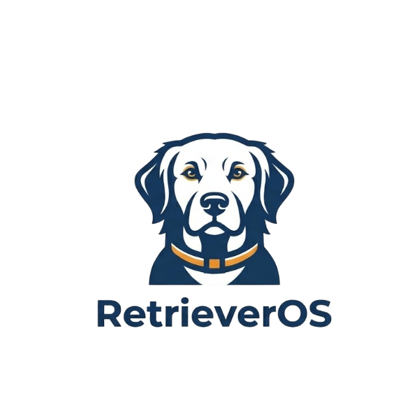

# RetrieverOS - Open Source hybrid RAG application

[](LICENSE)
[](https://www.python.org/)
[](https://github.com/patilakshay111/RetrieverOS/actions/workflows/tests.yml)

<p align="center">
  <picture>
    <source media="(prefers-color-scheme: dark)" srcset="docs/assets/retrieveros-logo-dark.png" />
    
  </picture>
</p>

A production-minded, open-source hybrid RAG application with a Python 3.11+ FastAPI backend and a React/TypeScript web dashboard. It supports Markdown, text, HTML, and PDF documents; local FAISS/BM25 retrieval and shared Qdrant/PostgreSQL dense and full-text retrieval; weighted Reciprocal Rank Fusion; an optional cross-encoder reranker; grounded OpenAI answers; per-claim citation checks; and confidence scoring.

The RAG workflow is implemented as a LangGraph `StateGraph` with Pydantic state and bounded recent-turn history. PostgreSQL deployments use the LangGraph PostgreSQL checkpointer and server-generated, user/workspace-scoped conversation IDs; local development can use the in-memory `MemorySaver`. The React dashboard supports Keycloak sign-in, isolated workspaces, document ingestion, chat with citations, retrieval comparison, invitations and role management, private API keys, and platform operations.

Contributions and issue reports are welcome. See [CONTRIBUTING.md](./CONTRIBUTING.md) for the development and pull request workflow.

## Local multi-service stack

The Compose project is named `retrieveros` (images and volumes are
`retrieveros-*`). The Compose file starts the API and dashboard plus local
Postgres, Redis, Qdrant, Keycloak, and Mailpit services. The Keycloak
service is **not** the stock image: it is built from `deploy/keycloak/Dockerfile`
(stock `quay.io/keycloak/keycloak:26.3.2` plus the RetrieverOS provider in
`deploy/keycloak-provider/`, see its README). Generate local-only service
passwords and an encryption key, then add your OpenAI key:

```powershell
python scripts/init_local_env.py
notepad .env
docker compose up --build
```

The React dashboard is at <http://localhost:5173>, the API at
<http://localhost:8000/docs>, Keycloak at <http://localhost:8080>, and the
Mailpit inbox at <http://localhost:8025>. All host ports bind to loopback.
Docker Desktop (or another Docker Engine) must be running.
Compose runs the Alembic database migration before starting the API.
For an externally managed PostgreSQL database, run `alembic upgrade head`
with that environment's `DATABASE_URL` before deploying the API.

On a new Compose volume, Keycloak imports the `retrieveros` realm with the
public `retrieveros-web` client, PKCE S256, and the API audience mapper.
Registration requires email verification; local verification and password
reset messages appear in Mailpit. The realm also ships a custom
`retrieveros first broker login` flow: Google identities must carry
`email_verified=true` (checked against Google's verified identity claim) and
matching Google accounts are auto-linked to the existing same-email local
account without an additional challenge — unverified Google identities are
rejected. No email-verification fallback is offered on this path, so a
Google account that asserts an unverified email cannot take over an existing
local account. To enable Google login, set `GOOGLE_OAUTH_CLIENT_ID` and
`GOOGLE_OAUTH_CLIENT_SECRET` in `.env` to OAuth credentials from your own
Google Cloud project (never put those credentials in source control or this
chat), then run `python scripts/configure_keycloak.py` — it creates the
Google IdP automatically and points you at the broker flow check. Keycloak does not re-import a
realm over an existing persistent realm. If the volume already contains
`retrieveros`, update that realm's web client and audience mapper in the
Keycloak Admin Console rather than deleting identity data — note that an
already-imported realm also keeps whatever `firstBrokerLoginFlow` it has;
re-create the volume or import `deploy/keycloak/retrieveros-realm.json` to
pick up the custom broker flow.

The API verifies Keycloak access-token signatures, issuer, audience, and
expiry. It resolves workspace membership and application permissions from
PostgreSQL on every request; workspace IDs, role names, and permission claims
from the browser or identity token are not trusted. A new account does not get
an implicit workspace: first sign-in prompts the user to create one with a
name and description. Its creator becomes the initial workspace admin. An
invited user can accept an invitation before creating any workspace and is
then taken directly to the invited workspace; users can create additional
workspaces later. Select an active workspace in the dashboard or use the
`X-Workspace-ID` header for workspace-scoped API calls.

The built-in `admin`, `ceo`, `employee`, and `hr` roles are defined separately
inside each workspace. Workspace admins can create additional roles and choose
among `documents:read`, `documents:query`, `documents:upload`, and
`documents:update`; they can also edit workspace details, manage members, and
invite users with one or more workspace roles. A member's capabilities are the
union of their assigned roles. Document ACLs can include multiple roles, and
the API validates every ACL role against the active workspace before
embedding or storing content. For non-admin members, visibility and retrieval
also require an ACL role match and the corresponding capability.

The `platform-admin` Keycloak realm role is separate from workspace roles; it
grants audited platform-level access and does not replace workspace-local role
definitions. Invitation acceptance requires the invitee's verified OIDC email
to match the invitation; invitation tokens are stored hashed, expire after the
configured period (72 hours by default), and can be accepted once. Configure
`SMTP_*` in `.env`; Compose sends verification and invitation mail to Mailpit.
Privileged cross-workspace API access is recorded in PostgreSQL with an
action, target, actor, timestamp, and request ID, without recording prompts,
documents, answers, or tokens. The API applies workspace, owner, capability,
and document-ACL checks before returning documents or passing retrieved
evidence to the answer graph. Conversation checkpoints are namespaced by user
and workspace.

With OIDC enabled, each user can save, rotate, or delete their own OpenAI key
from the dashboard. The API encrypts keys in Postgres using
`USER_KEY_ENCRYPTION_KEY`; generate a fresh key for every deployment and keep a
secure backup, because losing it makes stored credentials undecryptable. Key
plaintext is not returned by the API. In local development without OIDC, the
legacy shared `OPENAI_API_KEY` remains available.

**This is an in-progress production-hardening effort, not a production-ready
deployment.** The React dashboard, workspace authorization, invitation APIs,
and cross-workspace audit logging are implemented. They have not yet been
validated end to end with the local Compose stack. The local images built,
all services became healthy, and `/readyz` reported Postgres, Qdrant, and Redis
ready. Browser sign-in requires the `retrieveros` realm to be freshly imported
(it ships the `retrieveros-web` client, its audience mapper, and the
verified-Google-email broker flow); the pre-rename persistent Keycloak realm
does not contain those, so re-create the volume before validating sign-in,
invitations, two-user workspace isolation, or ingestion/chat. When both
`QDRANT_URL` and `DATABASE_URL` are configured, ingestion writes vectors to
Qdrant and current chunks to the PostgreSQL catalog, and retrieval uses those
shared stores. Native development without both settings continues to use local
FAISS and BM25. Redis rate limits/cache and PostgreSQL conversation
checkpoints are implemented but still need local integration verification.
OpenTelemetry and deployment automation remain future work; Kubernetes is out
of scope. GitHub Actions runs backend and frontend checks, validates Compose,
and builds the container image; it does not publish or deploy an image. Render
validation follows successful local integration testing. Do not expose this
stack to the public internet or ingest confidential documents yet.

## Production data flow

These diagrams follow the implemented ingestion and question-answering paths.
With both `QDRANT_URL` and `DATABASE_URL` configured, Qdrant provides dense
candidates and PostgreSQL provides the current-chunk catalog and full-text
search. Otherwise, retrieval uses the local FAISS snapshot and in-process
BM25. Document embeddings and answer/judge calls use the configured OpenAI
models.

### Ingestion and index publication

```mermaid
%%{init: {'theme': 'dark', 'themeVariables': { 'primaryColor': '#0d1b2a', 'primaryTextColor': '#ffffff', 'primaryBorderColor': '#4cc9f0', 'lineColor': '#4cc9f0', 'secondaryColor': '#1b263b', 'tertiaryColor': '#4cc9f0' }}}%%
flowchart LR
    upload["Document upload"] --> api["POST /v1/ingest"]
    samples["Sample documents"] --> seed["seed.py"]
    archive["Archived documents"] --> reindex["reindex.py<br/>verify source hash"]
    api --> ingest["Parse and chunk<br/>selected strategy"]
    seed --> ingest
    reindex --> ingest
    ingest --> embed["Embed chunks<br/>configured OpenAI model"]
    embed --> dedupe["Deduplicate and replace<br/>this source's chunks"]
    dedupe --> durable{"QDRANT_URL and<br/>DATABASE_URL configured?"}
    durable -->|Yes| vectors["Upsert accepted vectors<br/>Qdrant with ACL payload"]
    vectors --> catalog["Replace workspace/source<br/>PostgreSQL catalog rows"]
    durable -->|No| stage["Write complete staged<br/>local index generation"]
    catalog --> stage
    stage --> publish["Atomically publish<br/>local index/CURRENT"]
    publish --> remote{"Durable mode?"}
    remote -->|Yes| cleanup["Delete superseded Qdrant IDs"]
    remote -->|No| active["Active local snapshot"]
    cleanup --> active
    cleanup --> qdrant["Qdrant collection"]

    classDef input fill:#0d1b2a,stroke:#4cc9f0,color:#ffffff;
    classDef process fill:#1b263b,stroke:#4cc9f0,color:#ffffff;
    classDef storage fill:#0d1b2a,stroke:#ffd166,color:#ffffff;
    classDef provider fill:#1b263b,stroke:#06d6a0,color:#ffffff;

    class upload,samples,archive input;
    class api,seed,reindex,ingest,dedupe process;
    class stage,publish,active,catalog,qdrant storage;
    class vectors process;
    class embed provider;
```



### Question answering

```mermaid
%%{init: {'theme': 'dark', 'themeVariables': { 'primaryColor': '#0d1b2a', 'primaryTextColor': '#ffffff', 'primaryBorderColor': '#4cc9f0', 'lineColor': '#4cc9f0', 'secondaryColor': '#1b263b', 'tertiaryColor': '#4cc9f0' }}}%%
flowchart LR
    client["React SPA or API client"] --> ask["POST /v1/ask"]
    ask --> limit["Redis rate limit<br/>ask, ingest, compare"]
    limit -->|Allowed| resolve["Resolve conversation<br/>derive scoped thread ID"]
    limit -->|Denied or unavailable in production| limited["429 or 503"]
    resolve --> eligible{"Stateless call<br/>and no checkpointer?"}
    eligible -->|Yes| lookup["Redis answer-cache lookup"]
    lookup -->|Hit| response["Return answer, evidence,<br/>citations, scores, conversation_id"]
    lookup -->|Miss or cache error| workflow["RAGService / LangGraph"]
    eligible -->|No| workflow
    workflow <--> checkpoints["PostgreSQL checkpointer<br/>or local MemorySaver"]
    workflow --> query["Build query from question<br/>and recent history"]
    query --> embed["Embed query<br/>configured OpenAI model"]
    embed --> scope{"Shared stores configured?"}
    scope -->|Yes| dense["Qdrant dense search<br/>workspace/owner/role filters"]
    dense --> catalog["PostgreSQL catalog check<br/>current authorized chunk IDs"]
    catalog --> fusion["Fuse authorized candidates"]
    scope -->|Yes| lexical["PostgreSQL full-text search<br/>workspace/owner/role filters"]
    lexical --> fusion
    scope -->|No| local["FAISS dense +<br/>in-process BM25"]
    local --> fusion
    fusion --> rerank["Optional cross-encoder reranking"]
    rerank --> gate{"Retrieval confidence<br/>below threshold?"}
    gate -->|Yes| abstain["Return insufficient-context answer"]
    gate -->|No| answer["Generate grounded answer<br/>OpenAI"]
    answer --> citations["Verify cited claims<br/>LLM judge"]
    citations --> completeness["Assess completeness<br/>LLM judge"]
    abstain --> score["Calculate final confidence locally<br/>append turn to history"]
    completeness --> score
    score -->|Stateless cache eligible| cache_write["Store bounded response<br/>with hashed scoped key and TTL"]
    cache_write --> response
    score -->|Otherwise| response
    response --> client

    classDef client fill:#0d1b2a,stroke:#4cc9f0,color:#ffffff;
    classDef service fill:#1b263b,stroke:#4cc9f0,color:#ffffff;
    classDef decision fill:#0d1b2a,stroke:#ffd166,color:#ffffff;
    classDef provider fill:#1b263b,stroke:#06d6a0,color:#ffffff;

    class client,response client;
    class ask,limit,limited,workflow,query,retrieve,embed,dense,catalog,lexical,local,fusion,rerank,abstain,score service;
    class gate,eligible decision;
    class lookup,cache_write storage;
    class answer,citations,completeness provider;
```



For low retrieval confidence, the graph skips answer generation, citation verification, and completeness judging; it returns an insufficient-context response instead. Otherwise, the confidence score combines retrieval confidence, citation coverage, and the completeness assessment. `POST /v1/compare` runs this answering path twice, once in hybrid mode and once in dense-only mode, using separate server-derived checkpoint variants for the same authorized conversation.

## Run the application on Windows

Use your installed global Python (3.11 or newer); this guide does not create a virtual environment. From the project root, check Python and install the project and its development tools into that Python installation:

```powershell
python --version
python -m pip install -e ".[dev]"
python scripts/init_local_env.py
notepad .env
```

In `.env`, set `OPENAI_API_KEY` to your real OpenAI API key. Keep `APP_ENV=development` for local use. `API_KEY` can remain blank for a local-only demo; if you set it, send the same value as `X-API-Key` when calling protected endpoints. Do not commit `.env`.
For native local development, leave `QDRANT_URL` blank; Docker Compose
configures its internal Qdrant service automatically. Shared retrieval
requires both `QDRANT_URL` and `DATABASE_URL`; production configuration uses
Qdrant and PostgreSQL. `QDRANT_VECTOR_SIZE` defaults to 1536 for the default
`text-embedding-3-small` model and must match the configured embedding model.
For this native-Python setup (not Docker Compose), set SQLite as the local
credential store in the API terminal before starting it:

```powershell
$env:DATABASE_URL = "sqlite:///./data/runtime/credentials.db"
```

Docker Compose overrides `DATABASE_URL` with its Postgres service address and
runs migrations automatically. Compose also connects the API to its Redis
service for request limits and optional stateless answer caching. For native
development, leave `REDIS_URL` blank unless a Redis server is running; a VS
Code Redis extension is only a client and does not start the Redis server.

Production requires `REDIS_URL`. Redis-backed rate limits are enforced for
ingest, ask, and compare requests, and Redis outages fail those requests closed.
Answer cache entries use hashed question/scope keys, bounded values, and a
short TTL. Caching is intentionally skipped when conversation checkpoints are
active so a cache hit cannot bypass conversation-history updates.

### 1. Index the bundled sample documents

```powershell
python -m rag_pipeline.seed
```

This embeds the sample corpus and publishes its local snapshot; when both
`QDRANT_URL` and `DATABASE_URL` are configured, it also writes to Qdrant and
the PostgreSQL chunk catalog. It requires `OPENAI_API_KEY`. Re-running it
refreshes the same sample documents. To select a chunking strategy, use
`python -m rag_pipeline.seed --strategy fixed`, `recursive`, or `semantic`.

### 2. Start the API and dashboard

The full multi-user application, including Keycloak and its backing services,
runs through Compose:

```powershell
docker compose up --build
```

Open the dashboard at <http://localhost:5173>. The API health check is
<http://localhost:8000/healthz>, interactive API documentation is at
<http://localhost:8000/docs>, and Mailpit is at <http://localhost:8025>.
For frontend hot reload, run `npm --prefix web ci` and then
`npm --prefix web run dev` in place of the Compose dashboard service; Vite
proxies API requests to the local API.

### 3. Use the application

- Register and verify an account using the link in Mailpit, then sign in through Keycloak. If the account has no membership, create a named workspace; an invited user should accept the invitation using the invited email and will land in that workspace. Save a private OpenAI key in Account settings before asking or ingesting unless the API has a shared `OPENAI_API_KEY`.
- In Workspace, admins can edit the workspace name and description, create roles with explicit permissions, assign one or more roles to an invitation, and manage member roles. Keycloak realm roles do not define these workspace permissions.
- Ask questions in the dashboard. Answers include retrieved evidence, citations, confidence breakdowns, and citation-verification results. Compare hybrid and dense-only retrieval from the chat workflow.
- Upload supported Markdown, text, HTML, or PDF files from Documents and choose a chunking strategy and one or more workspace access roles. `documents:read`, `documents:upload`, and `documents:update` govern inventory, new uploads, and replacements respectively; `documents:query` governs chat and conversation history. The API also supports `/v1/documents`, `/v1/ask`, and `/v1/compare`.
- The default reranker downloads its cross-encoder model the first time it is used; that first query may need network access. Set `RERANKER_ENABLED=false` in `.env` to disable it for a lightweight local run, then restart the API.
- To rebuild embeddings from the documents already indexed, run `python -m rag_pipeline.reindex`. This also requires the API key for OpenAI embeddings.

## Test and compare retrieval

### Run offline tests

These tests use deterministic local fakes and do not call OpenAI:

```powershell
python -m pytest
npm --prefix web ci
npm --prefix web test
npm --prefix web run lint
npm --prefix web run build
npm --prefix web audit --audit-level=high
```

### Compare retrieval modes

The dashboard toggle compares **hybrid** (dense + lexical retrieval with
fusion) against **dense-only** for the same question. Local mode uses BM25;
shared mode uses PostgreSQL full-text search. `POST /v1/compare` returns both
results. To query sparse-only retrieval as well, use `POST /v1/ask` in the
API docs and choose `sparse`; the endpoint also accepts `hybrid` and `dense`.

For example, with the API running in local development mode and no `API_KEY` configured:

```powershell
$body = @{
    question = "What is the incident escalation process?"
    retrieval_mode = "sparse"
    thread_id = "readme-sparse-test"
} | ConvertTo-Json

Invoke-RestMethod `
    -Uri "http://localhost:8000/v1/ask" `
    -Method Post `
    -ContentType "application/json" `
    -Body $body
```

If `API_KEY` is configured, add `-Headers @{ "X-API-Key" = "<your API key>" }` to the request.

### Compare chunking strategies with the evaluation set

```powershell
python -m rag_pipeline.evaluation.run
```

This runs the 50-case golden set over **fixed**, **recursive**, and **semantic** chunking strategies, using hybrid retrieval for each. It writes JSON details and a Markdown comparison under `data/evaluation/results/`. Unlike the offline tests, this evaluation calls OpenAI for embeddings, answers, and LLM judging, so it requires `OPENAI_API_KEY`, can make many model calls, and may incur API costs. The report contains measured results from your run; no benchmark scores are assumed or prefilled.

## LangGraph local development

The root `langgraph.json` points the LangGraph CLI at the same compiled workflow used by `RAGService`, through `src/rag_pipeline/dev_graph.py`. The `dev` extra installs the local development CLI and requires `langgraph-api` 0.17.0 or newer:

```powershell
python -m langgraph_cli dev
```

Open the Studio URL printed by the CLI to inspect `internal_docs_rag`; the server and graph visualization start without an OpenAI key. Invoking the graph requires `OPENAI_API_KEY` and an indexed corpus. This is local development mode, not a LangSmith-hosted deployment.

## Repository layout

```text
src/rag_pipeline/         Application package, API, graph, and CLI entrypoints
web/                      React/TypeScript/Vite multi-user dashboard
tests/                    Offline unit and integration tests
data/sample_docs/         Synthetic sample corpus used by the demo
data/evaluation/          Golden evaluation dataset and generated results
deploy/keycloak/          Keycloak image + realm import (RetrieverOS Google-email gate)
deploy/keycloak-provider/ Java source for the RetrieverOS broker authenticators
docs/                     Public project documentation
.private/                 Local-only source/reference documents (Git-ignored)
```

The original requirements brief, interview rules, and engineering assessment are local references and are intentionally excluded from Git. The ignore rules are specific; Markdown files are not ignored globally, so the public docs and synthetic sample corpus remain part of the project.

See the [project recreation guide](./docs/PROJECT_RECREATION_GUIDE.md) and [case study](./docs/CASE_STUDY.md).

## API

- `GET /healthz`: process liveness.
- `GET /readyz`: readiness, including configured credential-store availability.
- `GET /v1/admin/operations/reindex-dry-run`: platform-admin-only verification
  of archived source digests and safe reindex metadata; it never changes the index.
- `GET /v1/documents`: indexed document inventory.
- `POST /v1/ingest`: multipart document upload and chunking strategy.
- `POST /v1/ask`: grounded answer with citations, retrieved chunks, and confidence.
- `POST /v1/compare`: hybrid and dense-only responses for the same question.
- `GET`, `POST /v1/conversations`: list conversations in the active workspace or create one.
- `GET`, `DELETE /v1/conversations/{conversation_id}`: read or delete only an owned conversation and its checkpoints.
- `GET`, `PUT`, `DELETE /v1/account/openai-key`: inspect whether the caller's
  key is saved, encrypt and save/rotate it, or delete it.
- `GET /v1/workspaces`: list caller memberships (platform admins can list all).
- `POST /v1/workspaces`: create a named workspace and initial admin membership.
- `PATCH /v1/workspaces/{workspace_id}`: update name and description as a workspace admin.
- `GET`, `POST /v1/workspaces/{workspace_id}/roles`: list or create workspace-local roles with explicit permissions.
- `GET /v1/workspaces/{workspace_id}/members`: workspace-admin member listing.
- `POST /v1/workspaces/{workspace_id}/members`: add a user with existing roles.
- `PUT`, `DELETE /v1/workspaces/{workspace_id}/members/{user_id}`:
  update or remove a workspace member.
- `POST /v1/workspaces/{workspace_id}/invitations`: send a verified-email
  invitation.
- `POST /v1/invitations/accept`: accept an invitation using a token in the
  JSON request body.

Protected API calls require a bearer token when `OIDC_ISSUER_URL` is set.
Workspace-scoped routes require an active workspace selection and use current
PostgreSQL membership and permissions; listing/creating workspaces and
accepting an invitation are identity-only operations. Privileged
cross-workspace access is audited. Invitation messages are delivered through
configured SMTP; local Compose uses Mailpit.
The React Operations view displays dependency readiness and the read-only
reindex dry-run report. Only platform administrators can view the report; it
contains source names, digests, byte counts, and chunking strategies, not
document contents or access-control metadata.

For local development, set `API_KEY` to require `X-API-Key`. If
`OIDC_ISSUER_URL` is configured, protected API routes require a verified bearer
token instead. Production startup requires HTTPS OIDC, PostgreSQL, encrypted
per-user key storage, and rejects wildcard CORS. Uploads are size-limited; raw
uploads and immutable index generations are stored under `DATA_DIR`.

## Architecture notes

- Without both `QDRANT_URL` and `DATABASE_URL`, FAISS `IndexFlatIP` stores normalized embeddings and supports exact cosine-ranked lookup on local disk. `chunks.json`, `vectors.npy`, and the FAISS index are committed as one generation behind an atomic pointer; BM25 is built from that snapshot.
- With both settings, Qdrant stores dense vectors with workspace, owner, and role payloads, while PostgreSQL stores the current chunk catalog and indexed full-text search data. Both stores apply authorization filters before ranking. Dense candidates are checked against the current catalog before fusion so stale Qdrant points are not returned.
- With a PostgreSQL `DATABASE_URL`, LangGraph conversation checkpoints and conversation metadata are durable across API process restarts. Checkpoint thread IDs are derived from the authenticated user, workspace, and server-generated conversation UUID; the request's legacy `thread_id` is not used as an authorization key. Without PostgreSQL, local/test operation retains in-memory checkpoints.
- Redis provides atomic, per-user/workspace rate limits. Optional answers are cached only for stateless calls; checkpointed conversations always execute through the graph so history remains correct. Readiness reports PostgreSQL, Qdrant, and Redis dependency states without exposing connection details.
- Durable ingestion writes accepted vectors, replaces the source's catalog rows in one database transaction, publishes the local snapshot, then removes superseded Qdrant point IDs. The Qdrant and PostgreSQL operations are not one cross-service transaction.
- Duplicate chunks with cosine similarity above the configured threshold are skipped.
- Confidence combines calibrated retrieval relevance, claim-level verified citation coverage, and an LLM completeness assessment. Low retrieval confidence returns a structured abstention.
- Original uploads are content-addressed under `DATA_DIR/raw`; `rag-pipeline-reindex --dry-run` verifies every archived source digest and prints the planned operation without changing the index. Run `rag-pipeline-reindex` to re-embed the manifest after the dry run.
- The default reranker is `cross-encoder/ms-marco-MiniLM-L-6-v2`. It loads on the first query and may need network access to download model weights; disable it for a lightweight offline test using `RERANKER_ENABLED=false`.
- The sample corpus is synthetic. Do not ingest confidential material into a demo environment.
